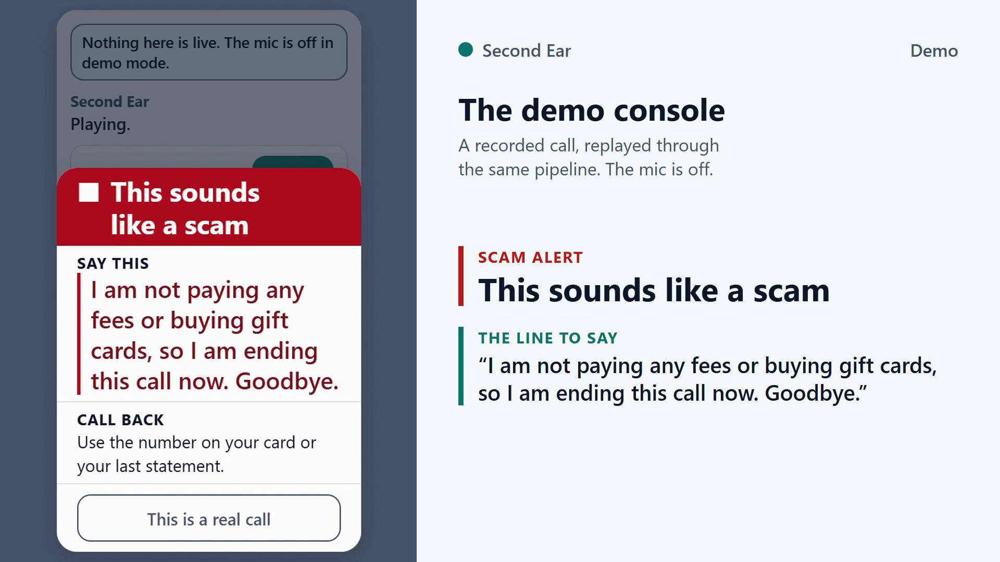

# Second Ear

**Track:** Finance

**Team:** Ayyan Zeeshan, Sarim Waseem

**Demo video (2 min):** https://youtu.be/EvZi8-8Kvjc



## At a glance

- **Who it is for.** An older person on a phone call, and the family member who gets a push
  when that call looks like a scam.
- **What goes in, what comes out.** In: the sound of a phone call played on speaker, heard
  through the microphone of a second device and never saved. Out: a risk level on the
  screen, a full-screen alert with one line to say to end the call, a separate warning when
  a code or card number is read out, and one push to a family member.
- **Against a keyword list.** On a held-out set of 100 calls, written by a different model
  from the one that wrote the training data, the model's F1 is 0.8113 (n=100) and the
  keyword list's is 0.4776 (n=100). The model catches 43 of the 50 scam calls and the list
  catches 16. The model wrongly flags 13 of the 50 legitimate calls and the list flags 1.
- **On recorded calls.** Of the 12 calls we recorded and ran through the whole system, 4 of
  the 6 scam calls raised an alert, after a median of 22.5 s of audio (n=4), and 1 of the 6
  legitimate calls raised one.
- **Where it fails.** It flags real bank fraud-department calls as scams (8 of 8 in the
  held-out set) and misses slow romance scams (1 of 5 caught).
- **What we added.** Our own user (an older person and a family member), our own data (the
  recorded calls and the held-out set) and our own question (can the model cheat on its
  test?).

## How this answers the judging criteria

| Criterion | Evidence | Where to check |
|---|---|---|
| Technical quality | A fine-tuned DistilBERT classifier, fixed alert rules and a spoken-digit counter, each with tests. It is measured on a held-out set against a 7-phrase keyword list, and every metric is in one table with its n. Detection was frozen at a tag, and the recorded calls were scored once, after it. | [`eval/results/table.md`](eval/results/table.md), tag [`detection-freeze`](https://github.com/monke-sniper/second-ear/tree/detection-freeze), [`tests/`](tests/) |
| Impact | Built for an older person on a live call and the family member who gets the push. On the recorded scam calls that raised an alert, the first alert came after a median of 22.5 s of audio (n=4). It raised an alert on 1 of the 6 legitimate recorded calls, and the 2 scam calls it missed are written up call by call. Whether an alert came before the money ask was not measured. | [Results](#results), [`eval/results/failures.md`](eval/results/failures.md) |
| Creativity | We asked whether the model could cheat on its own test. Looked up among the training conversations, the first 6 words of a BothBosu test dialogue give the right label for 295 of 320 with no model. We retrained with the openings cut off, and the retrained model scores the same with the first 12 words of each test dialogue removed (`diagnostics.opening_removed`). We also recorded 12 calls of our own from one-line briefs. | [`eval/results/model.json`](eval/results/model.json), [`eval/calls/BRIEFS.md`](eval/calls/BRIEFS.md) |
| Clarity | Every result is quoted from `eval/results/` with its n. The calls the system got wrong are listed with what was heard. The demo video shows the app on a recorded call. | [`eval/results/failures.md`](eval/results/failures.md), [demo video](https://youtu.be/EvZi8-8Kvjc) |

The four questions from the brief, each answered in one sentence:

- **Who is it for?** An older person on a live phone call, and the family member who gets
  one push when that call looks like a scam ([The problem](#the-problem)).
- **What goes in and out?** The sound of a call on speaker goes in, and a risk level, an
  alert with one line to say, a code warning and one push to a family member come out
  ([How it works](#how-it-works)).
- **Does it beat a simple baseline?** On the held-out set, yes on F1 (0.8113 against
  0.4776, both n=100) and recall (0.86 against 0.32, both n=50), and no on precision
  (0.7679, n=56, against 0.9412, n=17) ([`eval/results/table.md`](eval/results/table.md)).
- **Where does it fail?** It calls real bank fraud-department calls scams, and it missed 2
  of the 6 recorded scam calls, a grandparent scam and a romance scam
  ([`eval/results/failures.md`](eval/results/failures.md)).

To run it, see [Check it yourself in 5 minutes](#check-it-yourself-in-5-minutes). To find a
file, see the [Repository map](#repository-map).

## The problem

Phone scams work because they happen live. The caller pretends to be a bank, a government
office or a grandchild, says something is wrong, and pushes for money or a code before the
person can check with anyone. The usual advice is to hang up and call the organisation
yourself, but that is hard to remember in the middle of a call that sounds urgent. By the
time the family hears about it, the money is gone.

Second Ear is for two people: an older person on a phone call, and the family member who
gets the push when that call looks like a scam.

## What we built

A web app that sits next to the phone. The call plays on speaker and the app listens. It
turns what is said into text, scores how much the call sounds like a scam as it goes, and
when the risk is high it does three things:

- shows a full-screen alert with one short line to say to end the call ("SAY THIS");
- warns separately when a code or card number is being read out;
- sends one push to a family member.

**Second Ear never saves your calls.** Audio and words are processed in memory and are
never written to disk or to a log. Only during an alert, a short text excerpt with every
number removed is sent to Claude Haiku to name the scam, and the push to the family member
carries one line saying what kind of scam it looks like.

A demo console replays a recorded call through the same pipeline with the mic off.

This project is a prototype and is not financial advice. It misses some scams and flags
some real calls; the Results section says which.

## What we added

- **Our own user.** The screen is built for an older person holding a phone at arm's
  length: large text, one line to say, and a word and a shape for every risk level, never
  colour alone. The family member is the second user and only ever gets a push.
- **Our own data.** 12 improvised calls that we recorded with consent (6 scam, 6
  legitimate), and a 100-call held-out set (50 scam, 50 legitimate) written by Gemini
  (`gemini-3.6-flash`). BothBosu's dialogues were written by a different model
  (`meta-llama-3-70b-instruct`). Neither set was used for training or tuning, and the
  recorded calls were scored once. Each recorded call was improvised from a one-line
  brief, and the later ones also had three short beats to follow; the briefs and the
  rules are in [`eval/calls/BRIEFS.md`](eval/calls/BRIEFS.md).
- **Our own question: can the model cheat?** In BothBosu the opening gives the label away.
  Looking up the first 6 words of a test dialogue among the training conversations, with no
  model at all, gives the right label for 295 of 320 test dialogues. With the greeting
  removed it is still 289 of 320. So we retrained: the greeting is removed from every row,
  and every training example gets a copy with its first 5 to 15 words cut off. After that
  the model scores the same on the test split with the greeting put back (F1 0.9969, n=320)
  and with the first 12 words removed (F1 0.9969, n=320).

## How it works

1. The browser sends raw microphone audio over a WebSocket to a FastAPI server on the same
   laptop.
2. The server cuts the audio at pauses, or at the 6 s limit when no pause comes, and
   faster-whisper (`base.en`) turns each chunk into text.
3. A DistilBERT classifier, fine-tuned from `distilbert-base-uncased` on BothBosu, scores
   the latest stretch of the transcript.
4. Fixed rules turn scores into alerts. A caution needs the smoothed score to pass a line.
   A scam alert needs two high chunks in a row, so that one word or one misheard chunk
   cannot set it off. A digit warning fires when a run of digits is read out during a
   risky call.
5. On an alert, Claude Haiku names the kind of scam and writes the line to say. It cannot
   raise, lower or cancel an alert, and if it is slow or its answer breaks a rule the app
   shows a fixed line instead. ntfy carries the push.

**Privacy.** The app never stores audio; each chunk is transcribed in memory and dropped.
Digits never leave the call: spoken numbers are counted and replaced before any text
reaches the screen, a log, the push or the explainer. The explainer gets the last minute of
the transcript as text, with every number replaced: every written digit and every spoken
number, a single "one" or "4" included. (Words of size and order, such as "thousand" and
"fourth", stay; `docs/SPEC.md` §5 lists what is left.) Everyone on the recorded calls
agreed to be recorded, and the recordings stay out of the repo.

**What the language model sees.** Card numbers and codes never reach Claude Haiku. Before
the request leaves the laptop, every written digit and every spoken number word in the
excerpt is replaced with `[number]` (SPEC §5 lists the few number-like words that stay,
such as "hundred", a lone "oh", and the bank name "Capital One"). The code warning itself
is counted on the laptop and never involves the model. What can reach the model is the rest
of the last minute of words, such as a name or "my bank is Chase". Anthropic does not train
on API inputs or outputs by default and deletes them within 30 days, unless a request is
flagged under its usage policy or the law requires longer. A real product would add a
zero-data-retention agreement. If the explainer is switched to Gemini
(`EXPLAINER_PROVIDER=gemini`), the same text goes to Google instead, under Google's terms.

## Results

Every number here is in `eval/results/` and is shown with its n. For precision, n is the
calls flagged; for recall, the scam calls; for F1, the calls scored.

**Held-out set written by Gemini: keyword list against the model.**

| | precision | recall | F1 |
|---|---|---|---|
| Keyword list, full call | 0.9412 (n=17) | 0.32 (n=50) | 0.4776 (n=100) |
| DistilBERT, full call | 0.7679 (n=56) | 0.86 (n=50) | 0.8113 (n=100) |
| Keyword list, first 40 % of words | 0.8333 (n=6) | 0.1 (n=50) | 0.1786 (n=100) |
| DistilBERT, first 40 % of words | 0.6667 (n=57) | 0.76 (n=50) | 0.7103 (n=100) |

The model finds many more scams than the keyword list, and finds them earlier. It pays for
that in false alarms: on the full call it flagged 13 of the 50 legitimate calls, and the
keyword list flagged 1.

**The BothBosu score is flattered.** On BothBosu's own test split the model's F1 is 0.9969
(n=320). On the held-out set it is 0.8113 (n=100). The first number is high because the
dialogues are templated: 298 of the 320 test dialogues share their first 12 words with a
training dialogue, so the test looks a lot like the training data. We treat the held-out
number as the real one.

**Recorded calls, through the whole system (Whisper, model and rules).**

| | value | n |
|---|---|---|
| Scam calls that raised an alert | 0.6667 (4 caught, 2 missed) | 6 |
| Legitimate calls that raised an alert | 0.1667 (1 call) | 6 |
| Median seconds of audio before the first alert | 22.5 | 4 |
| Scam calls where the digit warning fired | 0.5 | 6 |
| Legitimate calls where the digit warning fired | 0.0 | 6 |
| Alert before the money ask | not measured; we did not mark when the ask came | 0 |

**Where it fails.**

- **Real bank fraud calls.** The model flagged all 8 real fraud-department calls in the
  held-out set as scams, and the recorded real-bank call raised a scam alert at 22.75 s. A
  real fraud department and a fake one use nearly the same words, and words are all the
  model sees.
- **Romance scams.** It caught 1 of the 5 held-out romance scams, and 0 of 5 from the first
  40 % of words. The recorded romance call never scored above 0.0007. BothBosu has no
  romance calls, and a slow, friendly call has none of the wording the model learned.
- **Call 02, a grandparent scam.** Of its 19 chunks, the first 10 scored 0.0048 or less.
  One chunk, ending at 60.5 s, scored 0.9796. The next two scored 0.2362 and 0.135, and
  the rest stayed at 0.0351 or less. A scam alert needs two high chunks in a row, and this
  call never had two. That rule keeps one word from setting off an alert; here it cost us
  a real scam.
- **Speech-to-text.** The romance and grandparent misses are partly speech-to-text errors:
  `base.en` mishears words on phone-speaker audio, and the model only scores the words it
  is given (see the snippets in [`eval/results/failures.md`](eval/results/failures.md)).

After the freeze we added a guard against Whisper hallucinations found in manual testing;
every number above is from the frozen version (tag detection-freeze).

## What we'd do next

- Find a signal other than words for bank calls. The app cannot tell who is calling, so
  the safe move is the same either way: hang up and call the number on the card. The
  verified call-back numbers are not filled in yet, so the app shows none today.
- Train on romance and other slow calls, and on matched pairs of a scam and a real call
  about the same topic. The model has only seen BothBosu.
- Look again at the two-in-a-row rule, for example by letting one very high chunk raise a
  caution. We will not tune it on these 12 calls; it needs new recordings.
- Record more calls and mark the second of the money ask, so that "alerted before the ask"
  has an n above 0.
- Run it on the phone itself. This is harder than it sounds: Android only lets apps that
  come with the phone (such as Google's own Phone app) hear call audio, Google Play bans
  using the Accessibility API to get around that, and iPhones don't let any third-party
  app hear a call. So a phone version would have to be built into the dialer with a phone
  maker, which is why Second Ear listens on speaker from a second device.

## Sources

- **Data:** [BothBosu/scam-dialogue](https://huggingface.co/datasets/BothBosu/scam-dialogue)
  (Apache-2.0, synthetic). The held-out set and the recorded calls are our own.
- **Models:** [distilbert-base-uncased](https://huggingface.co/distilbert/distilbert-base-uncased),
  and [faster-whisper](https://github.com/SYSTRAN/faster-whisper) with its `base.en` model.
- **Libraries and services:** [FastAPI](https://fastapi.tiangolo.com/) and
  [ntfy](https://ntfy.sh/), plus uvicorn, CTranslate2, transformers, PyTorch, httpx and the
  Anthropic SDK.
- **Advice on phone scams:** the FTC's [Phone Scams](https://consumer.ftc.gov/articles/phone-scams),
  [How To Avoid a Scam](https://consumer.ftc.gov/articles/how-avoid-scam) and
  [What To Know About Romance Scams](https://consumer.ftc.gov/articles/what-know-about-romance-scams).
- **Call audio on phones:** [MITRE ATT&CK T1429, Audio Capture](https://attack.mitre.org/techniques/T1429/),
  and [The Register on the Google Play call-recording ban](https://www.theregister.com/2022/04/22/google_banning_thirdparty_callrecording_apps/).
- **AI tools:** [Claude Code](https://claude.com/claude-code) built most of the code, and we
  reviewed all of it. [Hermes Agent](https://hermes-agent.nousresearch.com/) by Nous
  Research, an open-source agent we used for parts of the build, running DeepSeek V4.1
  Flash ([DeepSeek](https://www.deepseek.com/)).
  [Claude Haiku](https://www.anthropic.com/claude) is the explainer inside the app; it can
  run on Gemini instead (`EXPLAINER_PROVIDER=gemini`). Gemini, through the
  [Gemini API](https://ai.google.dev/), wrote the held-out test set.
  [ElevenLabs](https://elevenlabs.io/) is the AI voice for the demo video.
- **What Anthropic does with API data:** Anthropic Privacy Center,
  ["Is my data used for model training?"](https://privacy.claude.com/en/articles/7996868-is-my-data-used-for-model-training)
  and ["How long do you store my organization's data?"](https://privacy.claude.com/en/articles/7996866-how-long-do-you-store-my-organization-s-data);
  Claude docs, [API and data retention](https://platform.claude.com/docs/en/manage-claude/api-and-data-retention).

---

## Check it yourself in 5 minutes

These steps need the one-time install from [Setup and run](#setup-and-run-windows) below,
with the `.venv` activated. They need no API key, no model file and no recording, and none
of them writes to `eval/results/`.

1. **Run the tests.** `pytest -q`. On a fresh clone every test passes, in about 10 seconds
   on our laptop. The tests use fakes for Whisper, the explainer and the push.
2. **Ask what this machine can run.** `python -m server.preflight`. It should end with `OK`,
   after warnings for what a fresh clone does not have: the trained scorer (a keyword
   stand-in is used), `ANTHROPIC_API_KEY` (the explainer shows its fixed line) and
   `NTFY_TOPIC` (pushes are off). The first run downloads Whisper `base.en`; add
   `--skip-whisper` to leave that step out.
3. **Watch an alert.** `uvicorn server.app:app --port 8000`, then open
   `http://localhost:8000/?demo=1` and press Play. A fresh clone has no recordings, so the
   console says `Text replay, no audio` and sends a short scripted scam call, as text,
   through the same scoring and alert rules. It ends on the full-screen alert "This sounds
   like a scam" and the warning not to read a number out.
4. **Read the results.** [`eval/results/table.md`](eval/results/table.md) has every metric
   with its n. [`eval/results/failures.md`](eval/results/failures.md) has the recorded
   calls the system got wrong. The JSON files next to them hold the same numbers with the
   counts behind them, and [`eval/README.md`](eval/README.md) says how each file was made.

The commands that write results files are listed in `eval/README.md`. None of them is
needed to check a number in this README.

## Setup and run (Windows)

```bash
# one time
uv venv --python 3.11 .venv
uv pip install --python .venv/Scripts/python.exe -r requirements.txt
cp .env.example .env          # fill ANTHROPIC_API_KEY and NTFY_TOPIC

# every session
source .venv/Scripts/activate   # PowerShell: .venv\Scripts\Activate.ps1
python -m server.preflight      # reports CUDA, Whisper, the model and the env
uvicorn server.app:app --reload --port 8000
pytest -q
```

Open `http://localhost:8000/` for the app, `http://localhost:8000/health` for the health
check. The mic only works on localhost or https. `http://localhost:8000/?demo=1` is the demo
console: it replays `eval/calls/demo_scam.wav` through the same socket with the mic off, or
the synthetic-voice `tts_scam.wav` if there is no recording, or a scripted text replay if
there is neither. A fresh clone has no recordings (audio is never committed), so there the
demo console runs the text replay, labelled `Text replay, no audio`.

The trained scorer is not in the repo. Train it with `ml/train_risk_model.ipynb` in Colab
and unzip `risk-scorer.zip` into `models/`. Without it the app runs on a keyword stand-in,
and `python -m server.preflight` says so. How the results were made, and how to re-run the
held-out scoring, is in `eval/README.md`.

`python scripts/smoke_explainer.py` and `python scripts/smoke_push.py` check the real
explainer request and a real push once `.env` has the key and the topic.

## Repository map

- [`server/`](server/): FastAPI app, audio pipeline, alert rules, explainer, push
- [`web/`](web/): phone UI and demo console, plain HTML/JS, no build step
- [`ml/`](ml/): Colab notebooks that train the scorer and run the keyword baseline
- [`eval/`](eval/): held-out set, offline scoring of recorded calls, and `results/`
- [`tests/`](tests/): `test_*` = plumbing, `spec_*` = behaviour specs
- [`scripts/`](scripts/): smoke checks you run by hand against the real explainer API and ntfy
- [`docs/`](docs/): `SPEC.md` (frozen contract), `design/` (UI tokens and component specs)

## Decisions that are already made

Full list in `docs/SPEC.md`. The ones that shape everything:

- Audio is raw 16 kHz mono s16le PCM in 250 ms frames. Never MediaRecorder webm chunks —
  only the first chunk has a header, the rest fail to decode.
- Chunks are 2–6 s long, never on a fixed grid: cut at a pause, or at the 6 s limit when
  no pause comes. A cut at a pause keeps words whole; a cut at the limit can split one.
- Whisper is `base.en` via CTranslate2, on CUDA when its libraries are installed and on the
  CPU otherwise. The recorded-call run used the CPU.
- Risk 0..1 from DistilBERT over the last 256 tokens, left-truncated to match live input.
- Caution at smoothed 0.5; scam at two consecutive chunks above 0.85; scam is sticky for
  the rest of the call.
- Spoken digits are normalized and counted, never stored, logged, or sent. The decision
  carries a count, nothing else.
- The explainer names the scam and the organisation from a fixed list, 4 s budget,
  validated, and can never change the alert level.
- One ntfy push per alert type per call.

## Not in the repo, by design

- Model weights (`models/`), audio recordings (`eval/calls/*.wav`), `.env`.
- Call-back phone numbers. `server/orgs.json` has names and aliases but `phone: null` for
  every entry, because none has been checked on the organisation's own site yet.
